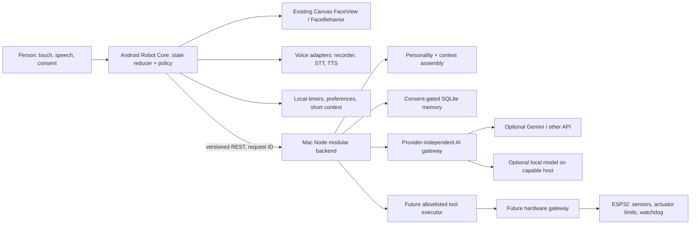
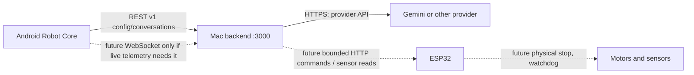
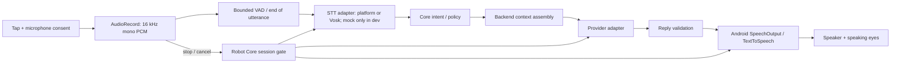
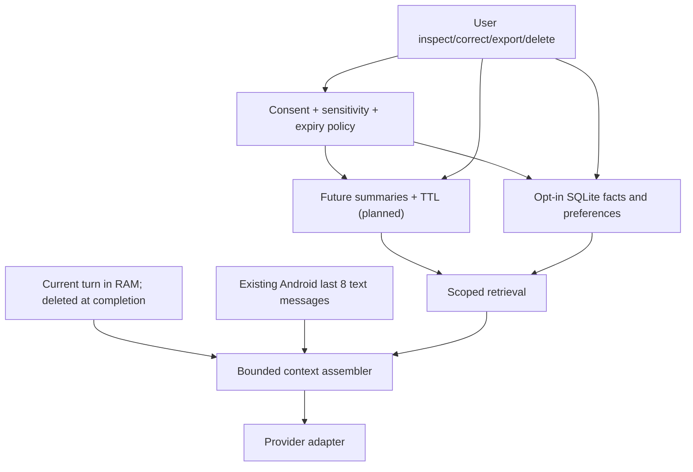
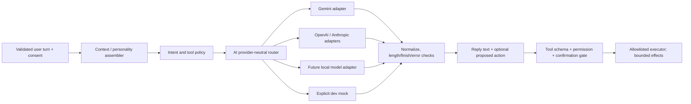
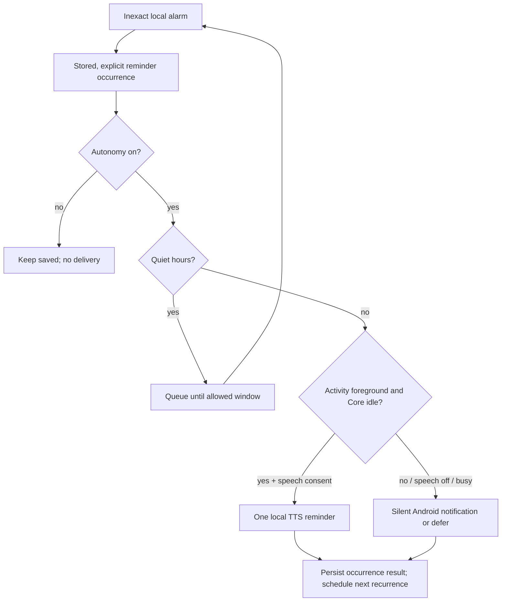
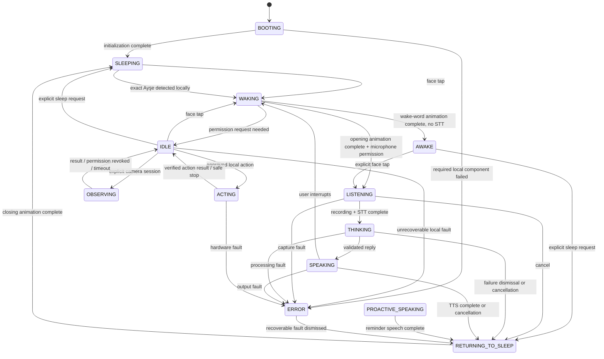
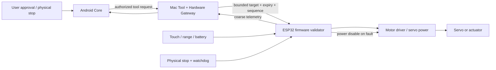

# Robot System Architecture

Status: Phase 1, the initial Phase 5 memory milestone, an initial Phase 6 reminder foundation, Phase 7.2 sleeping-face integration, and a Phase 7.3 local wake-word prototype are implemented. Phase 7.3 uses the exact Turkish phrase `Ayşe` with opt-in-only Vosk monitoring; physical recognition quality and performance are not verified. Android has a synchronous `RobotCore` reducer, typed events/effects, sleeping/waking/awake and voice states, microphone ownership, consent fields, session generation, lifecycle cancellation, memory management, and controlled reminder delivery. Android SQLite and inexact `AlarmManager` provide offline reminder delivery; backend SQLite/API mirrors reminder definitions and autonomy preferences. Autonomy and proactive speech default off; quiet hours default on. Physical wake-word false-activation, battery, and performance acceptance remains open. Per-device identity, encrypted local storage/transport, automatic summaries, camera, tools, and hardware behavior remain future work. See [Phase 6 reminders](PHASE6_REMINDERS.md), [Phase 7.1 wake-word decision](PHASE7_WAKE_WORD_DECISION.md), [Phase 7.2 sleeping face](PHASE7_2_SLEEPING_FACE.md), [Phase 7.3 local wake word](PHASE7_3_AYSE_WAKE_WORD.md), [vision](ROBOT_VISION.md), [technology choices](ROBOT_TECH_STACK.md), [roadmap](ROBOT_ROADMAP.md), [hardware plan](ROBOT_HARDWARE_PLAN.md), and [decisions](ROBOT_DECISIONS.md).

## 1. Baseline and migration boundary

Android `MainActivity` creates `RobotCore`, `FaceView`, `VoiceInteractionController`, `TextToSpeechManager`, a `ConversationEngine`, and the local reminder store/scheduler. `RobotCore` owns boot/sleep/wake/voice/proactive-speech/error activity state, session generations, microphone/consent state, and host pause/resume. It returns effects for the host to execute and rejects stale session events. `VoiceInteractionController` intercepts only explicit reminder commands from the current recognized transcript; ordinary conversation remains on the existing backend path. The backend provides health/config/conversation, memory, reminder CRUD, and autonomy settings routes. It bounds the eight-message conversation history, uses opt-in structured SQLite memories, and stores a separate validated reminder/settings mirror. The optional shared-token gate protects config, conversation, memory, and reminder routes when configured; Android stores the token encrypted with Android Keystore. A native Android speech recognition adapter is the default, but GM 5 Plus Turkish accuracy and offline behavior remain unverified. Per-device isolation, encrypted memory storage/transport, camera, tool execution, and ESP32 remain unimplemented.

Add **Robot Core on Android** as the single authority for the robot's visible/activity state, consent, session IDs, and device lifecycle. It receives events from the current voice controller and face; it does not replace their rendering/audio internals. Keep the backend as a **modular monolith** for AI, policy validation, future structured memory, and hardware gateway. The ESP32 later owns real-time electrical safety and rejects unsafe commands independently. A model never controls physical hardware directly.

### High-level system architecture



## 2. Ownership and module contracts

| Module | Owner, input, output, and hard limit |
| --- | --- |
| Robot Core | **Implemented foundation:** Android, owner-thread serialized synchronous reducer. Receives typed `RobotEvent`; emits immutable `RobotSnapshot` plus one-shot `RobotEffect` commands. Owns boot/idle/voice/error arbitration, microphone permission state, session generation, lifecycle cancellation, and optional consent/quiet-hours fields. Does not perform disk/network/audio work in the reducer. Camera/actuator effects and persisted policy are not implemented. |
| Face Engine | Existing `FaceView`/`FaceBehavior`/`FaceAnimator`. Maps a snapshot's expression, gaze, and status to Canvas drawing. Existing idle blinking stays local and cheap. Core can temporarily override behavior during voice/action/error. |
| Voice Engine | Existing `AudioRecorder`, `SpeechRecognizer`, `TextToSpeechManager`, `VoiceInteractionController` behind adapters. One microphone owner per turn. STT returns transcript + engine/offline metadata; TTS emits started/completed/error. Future VAD replaces the present fixed RMS threshold behind the recorder interface. A local wake detector is only a proposed extension; it must release capture before the existing STT acquires the microphone. |
| Personality Engine | Backend versioned configuration: stable traits, Turkish default, concise spoken style, honest capability claims. It produces prompt fragments and style bounds, not permissions or persistent facts. Android may hold a short offline greeting profile. |
| Emotion Engine | Android deterministic bounded vector, e.g. valence, arousal, curiosity, energy, engagement in `[0,1]`. Inputs are trusted events (interaction, response, inactivity), each has capped influence and decay. Emits face cue and optional TTS rate/pitch bounds. AI may suggest a cue, but Core validates/clamps it; model text cannot overwrite the state. |
| Memory Engine | Implemented initial backend SQLite repository/service stores structured profile, preference, fact, routine, and API-created summary records with source turn ID, confidence, timestamps, and active/deleted status. Android's existing last-eight history remains separate. Memory extraction and provider-context retrieval run only when Android sends explicit opt-in; retrieval is relevance-ranked and capped at five records. |
| AI Engine | Backend context assembly, intent/tool proposal, provider adapter, response validation. Keep `createProvider` and current Gemini/OpenAI/Anthropic/mock adapters. Optional local model adapter has the same normalized contract. Generation does not execute tools. |
| Autonomy Engine | Android local event scheduler and policy evaluator; no background model polling. Candidate actions require consent, cooldown, quiet-hour, presence-confidence, and budget checks. Backend is called only for an approved turn or action that truly needs AI. |
| Tool Engine | Backend allowlist with strict typed schemas, capability-specific permission, effect class (read-only / side effect / hazardous), resource bounds, idempotency, and audit event. Android presents consent. Hardware gateway and ESP revalidate commands. |
| Vision Engine | Future Android camera adapter for explicit short observation sessions; sample at low rate, discard frames promptly. Optional Mac inference receives only consented, bounded frames. No claim that person/object recognition fits the phone until benchmarked. |
| Hardware Engine | Future backend transport adapter plus ESP32 firmware. Device-independent `SensorReading`, `ActuatorTarget`, `Stop` interfaces. ESP owns servo limits, speed ramp, heartbeat timeout, and a physical stop. Loss of Mac/phone cannot remove local safety. |

### Placement matrix

| Responsibility | Android GM 5 Plus | Mac / Docker backend | ESP32 (future) | External AI (optional) |
| --- | --- | --- | --- | --- |
| Face, touch, lifecycle, permissions, user-visible state | **Owner** | — | — | — |
| Audio capture, on-device STT candidate, TTS | **Owner** | Optional offline STT fallback | — | Optional STT/TTS only after explicit cost/privacy review |
| AI request/context and provider secrets | Thin client | **Owner** | — | Selected text generation only |
| Canonical persistent memory, tool policy, schedules requiring host | UI/consent and bounded recent context | **Memory owner** | — | Relevant consented memories may be included in a generation request |
| Camera session | **Owner if enabled** | Optional heavier inference | Optional external camera module later | Optional, consented image processing only |
| Servo/sensor real-time safety | Stop/authorization request | Validated command gateway | **Final authority** | No direct access |

Mac outage: face, touch, and any verified on-device STT/TTS remain usable; cloud conversation and canonical memory report unavailable. ESP goes to safe neutral/disabled motion after its own heartbeat expires. A later Raspberry Pi can run the same Node container and SQLite volume if performance is measured; it is not a required dependency.

## 3. Communication and versioning



- **Now:** preserve `/healthz`, `/v1/config`, `/v1/conversations`, including `X-Request-ID`, normalized error codes, Turkish default, 1,800-character message bound, eight-message history, backend provider timeout (40 s Gemini default), and Android cancellation. `GET /v1/config` is already fetched per turn; a future capabilities document can extend it without breaking v1 clients.
- **Future REST:** introduce `/v2` only for incompatible envelopes. Add `GET /v1/capabilities`, explicit `/v1/memory/*`, `/v1/tools/*`, and `/v1/hardware/*` only after authentication/consent design and tests. JSON messages carry `schemaVersion`, `requestId` (UUID), `sessionId`, monotonic `eventSeq`, `timestamp` for display, and a typed payload. Never trust client timestamps for safety. Side effects require an idempotency key and have server-side deduplication.
- **Internal events:** use names such as `voice.recording.completed`, `conversation.reply.ready`, `sensor.proximity.changed`, `hardware.stop.requested`. A Kotlin sealed event type is preferable to an untyped string bus; Node modules can call each other and publish only local typed notifications. No broker in the first phases.
- **Timeouts/retry:** user conversations retain bounded connect/read timeouts and cancellation. Retry safe config/health reads with jitter, never blindly replay speech, memory deletion, or motion. Sensor telemetry may reconnect with exponential backoff and drop stale data. A received reply with an old `sessionId` is ignored.
- **Real time:** add WebSocket only when measured latency or event volume makes REST insufficient; heartbeat, sequence numbers, bounded queue, and reconnect snapshot required. MQTT is a later option for several ESP devices or complex pub/sub, not a baseline service.
- **Security:** current LAN HTTP is unencrypted; the optional shared-token gate protects configured API routes but does not hide requests from Wi-Fi observers. Keep HTTP on a trusted private Wi-Fi only. Before memory/remote tools/motors: add local pairing, per-device credentials stored in Android Keystore and backend host storage, authenticated requests, scoped capabilities, and tested TLS with certificate pinning or another authenticated encrypted channel. Do not embed credentials in the APK or expose port forwarding. ESP commands need short validity, sequence/replay checks, and device authentication; a plain LAN IP is not authorization.

Example future event envelope (illustrative; not a current endpoint):

```json
{"schemaVersion":1,"requestId":"uuid","sessionId":"uuid","eventSeq":12,"type":"sensor.proximity.changed","payload":{"distanceCm":42,"quality":"valid"}}
```

## 4. Voice pipeline



Phase 2 adds `SpeechInput` to separate microphone ownership from the recorded-PCM `SpeechRecognizer` adapter. `PlatformSpeechInput` uses Android's platform service by default and returns final text; the existing PCM capture plus HTTPS recognizer remains optional, and the mock requires explicit opt-in. Android documents `EXTRA_PREFER_OFFLINE=true` as offline-only; it is disabled by default because the GM 5 Plus Google service logged an offline SODA configuration failure. Enable it only after a Turkish model is confirmed. The normal system mode can use network or offline recognition depending on the service, so Turkish availability, latency, noise accuracy, and resource use still require measurement on the GM 5 Plus. Keep empty-result and service/network errors truthful; never log audio or transcript content. An optional Mac-side STT service needs a separate authenticated audio transport; the current conversation backend has no STT route.

Interruption priority: physical stop > app pause/permission revocation > user tap/barge-in > TTS completion > autonomous cue. On interruption, increment session generation, stop TTS/recorder, cancel the in-flight HTTP request, close PCM, and ignore late callbacks. Avoid simultaneous listening and speaker playback until echo behavior has been measured. Captions remain available if TTS fails.

**Wake-word status:** the only accepted phrase is `Ayşe`. Phase 7.3 adds an opt-in Vosk foreground service with local processing, no audio persistence/networking, explicit stop controls, and shared microphone leases. It transitions `SLEEPING -> WAKING -> AWAKE`; it does not start STT. The user must tap the face to begin the existing push-to-talk flow, and monitoring remains paused after speech in this phase. Physical acoustic accuracy and false-activation rate are not yet verified. See the [Phase 7.1 decision](PHASE7_WAKE_WORD_DECISION.md) and [Phase 7.3 implementation](PHASE7_3_AYSE_WAKE_WORD.md).

## 5. Memory and personality



Working memory is ephemeral per turn. The existing Android history remains a bounded context source and is not long-term memory. The backend SQLite database is the **single durable memory authority**. Version 1 stores `id`, `category`, `key`, `value`, `sourceRef`, `createdAt`, `updatedAt`, `lastAccessedAt`, `confidence`, `importance`, and active/deleted status. Deterministic explicit-statement patterns avoid questions/hypotheticals and reject several obvious sensitive-data classes; matching category/key corrections update the active record. Deletion marks a record deleted and blanks its user-content fields. There is no TTL or automatic summary extraction in this first implementation. No raw audio or conversation dump is stored.

| Layer | Proposed contents and lifetime |
| --- | --- |
| Working | Current intent, transcript, request ID, and tool candidate in RAM for one turn; zero/discard on completion. |
| Conversation | Existing last eight Android text messages; bounded context, removable with app data or a future explicit clear control. |
| Short-term | Existing eight-message Android text context, held separately in SharedPreferences. |
| Long-term | Opt-in backend facts/preferences/routines with source turn, confidence, updates, and deletion. |
| Relationship/context | Consented interaction preferences such as preferred name or quiet hours; no inferred intimacy score or claim of human attachment. |

Retrieval currently scores a bounded set of up to 500 active rows using lightweight normalized token overlap and returns at most five records above the confidence threshold. A vector database is not justified for this local dataset. Revisit retrieval quality only if tests show a measurable gap. The app supports inspect/edit/delete and clear-all; export UI is not implemented. Deleting long-term memory intentionally does not clear Android's separate recent conversation history. Backups of the Docker volume require their own deletion policy.

Personality traits are stable configuration, not learned permission. Emotion is a transient local vector that decays toward calm; it may change face cues and TTS delivery within accessibility-safe bounds. Model-generated emotional suggestions and memories are proposals, never authoritative writes.

| Simulated cue | Trusted trigger example | Face, voice, behavior mapping |
| --- | --- | --- |
| Happiness / calmness | Successful friendly turn / time since excitement | `HAPPY` / `NEUTRAL`, normal short Turkish speech, no extra initiative. |
| Curiosity / social engagement | User question / recent voluntary interaction | `CURIOUS` or `ATTENTIVE`, gaze toward user, one response; engagement decays with inactivity. |
| Surprise / excitement | Unexpected but validated event / user celebration | Brief `SURPRISED` then `ATTENTIVE` or `HAPPY`; small capped speech-rate change, cooldown to avoid repeated startling. |
| Sadness / low energy | User expresses sadness / prolonged idle | Gentle `SLEEPY` or a future subdued eye cue, slower bounded delivery and reduced proactive speech; never claim to diagnose the user or feel suffering. |

The existing seven eye expressions cover several cues but not a dedicated sad eye design. Add one only after visual/user testing. Emotion is not a permission source and cannot itself trigger paid AI, camera capture, or movement.

## 6. AI and tool boundary



Conversation generation, intent classification, tool proposal, and final response are separate operations even if one provider eventually performs several. Default path is one generation call, not a multi-agent chain. A tool proposal names a registered tool and schema version; the executor validates arguments, user authorization, scope, time, idempotency, and resource bounds. Read time/sensor data can be pre-authorized; reminders require user intent; camera, memory deletion, motion, and other impactful effects require explicit permission or confirmation. A refusal/error becomes a visible robot event, not a fabricated success. Provider failure falls back to a clearly labeled local response, never a forged cloud reply.

## 7. Controlled reminder delivery



Reminders are the only Phase 6 proactive trigger. They originate from an explicit schedule command or the settings UI; no idle AI loop, greeting, or memory-to-reminder conversion exists. Android stores the schedule and occurrence state locally, uses inexact alarms, defers through quiet hours or an active RobotCore turn, and falls back to silent notifications when speech is disabled or the app is backgrounded. TTS retries are bounded to three attempts. Defaults are autonomy off, proactive speech off, and quiet hours enabled at 23:00–08:00. Manufacturer alarm delay and reboot/process-death behavior still require physical GM 5 Plus acceptance; see [Phase 6 manual checks](PHASE6_REMINDERS.md).

## 8. Robot state machine



`BOOTING`, `IDLE`, `WAKING`, `AWAKE`, `LISTENING`, `THINKING`, `SPEAKING`, `PROACTIVE_SPEAKING`, `RETURNING_TO_SLEEP`, `SLEEPING`, `OBSERVING`, `ACTING`, and `ERROR` are **exclusive activity states**. Emotion, connectivity, and hardware safety are orthogonal snapshot fields, not more mutually exclusive states. Only Core's reducer commits transitions. Modules emit events with session IDs; stale completions are ignored. A local `Ayşe` detection opens the face into `AWAKE` without STT; a later face tap starts push-to-talk. A touch while asleep still starts the original wake animation and push-to-talk flow. A stop event can preempt any state, cancels effects, and disables motion. User interruption preempts `THINKING`/`SPEAKING`; autonomous candidates never preempt a user turn. Recoverable interaction errors show a short error face and return through `RETURNING_TO_SLEEP`; local capture/hardware faults may enter `ERROR` until capability recheck or user action. No automatic repeat of an actuation command.

The Phase 7.3 listener is opt-in and defaults off. It owns the mic only while active; push-to-talk first pauses it and obtains an exclusive mic lease. A detected wake stops capture before the Core event is sent. Automatic STT hand-off and monitoring restart after TTS remain later phases.

## 9. Future hardware path



ESP32 receives high-level bounded targets, not raw model prose or unconstrained PWM values. It enforces hard angle/speed/current/time limits and a heartbeat; a physical switch can cut motor power regardless of software. The backend records command outcome, and Android only announces success after an acknowledgment and observed final state. See [hardware plan](ROBOT_HARDWARE_PLAN.md) for wiring, power, and failure modes.
