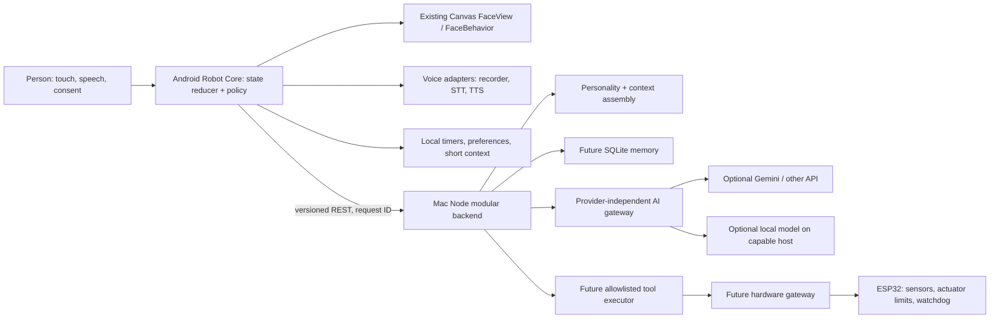
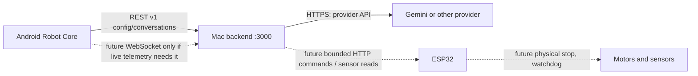
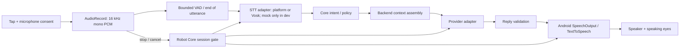
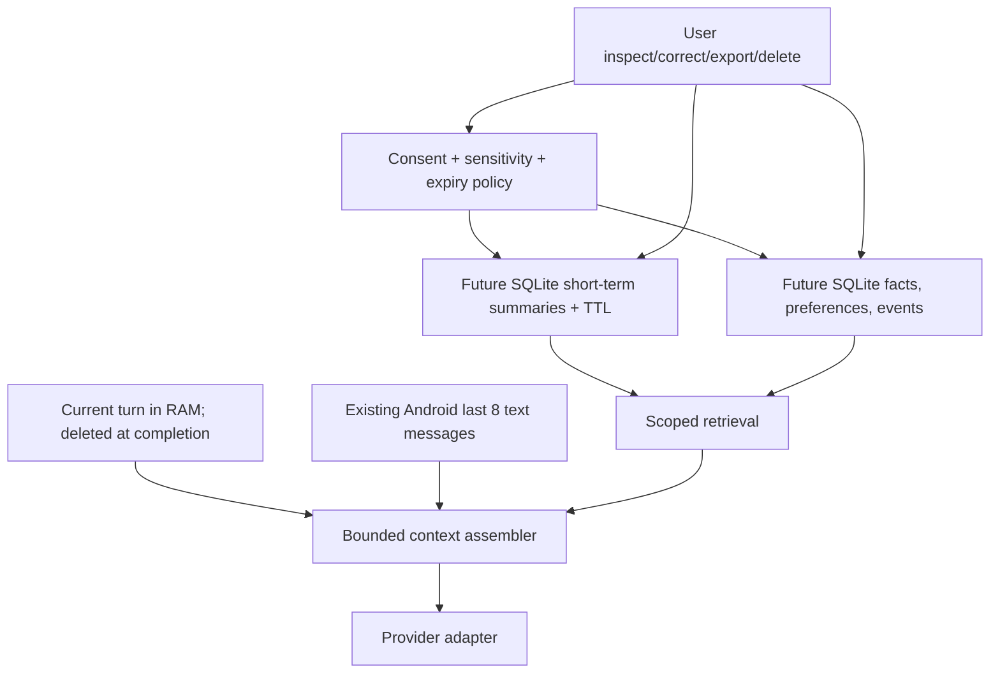
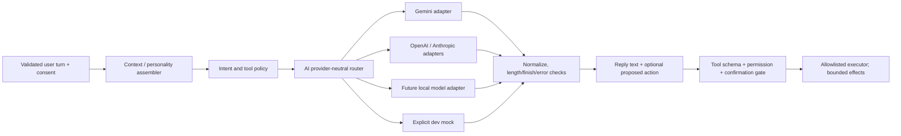
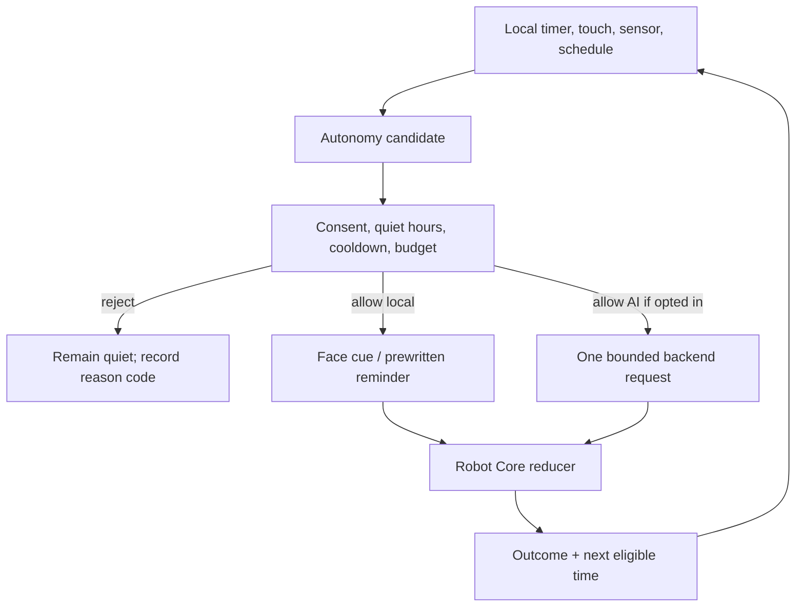
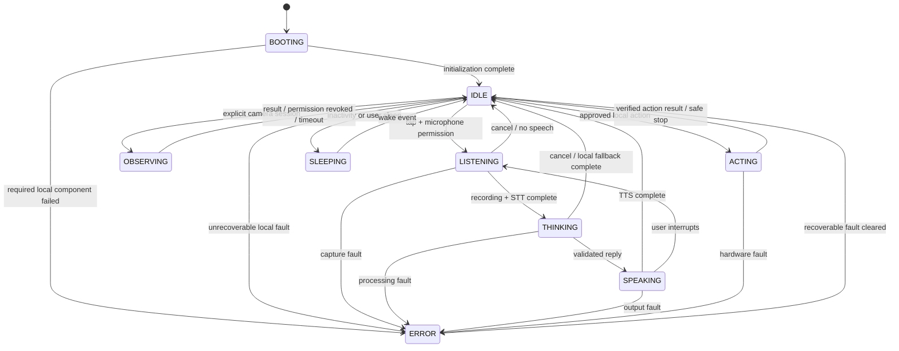
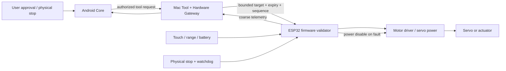

# Robot System Architecture

Status: architecture proposal with **Phase 1 foundation implemented**. Android now has a synchronous `RobotCore` reducer, typed events/effects, activity snapshots, microphone permission and optional-consent fields, session generation, and lifecycle cancellation. The camera, action, autonomous, durable-memory, and hardware behaviors described below remain future work. See [vision](ROBOT_VISION.md), [technology choices](ROBOT_TECH_STACK.md), [roadmap](ROBOT_ROADMAP.md), [hardware plan](ROBOT_HARDWARE_PLAN.md), and [decisions](ROBOT_DECISIONS.md).

## 1. Baseline and migration boundary

Android `MainActivity` now creates `RobotCore`, `FaceView`, `VoiceInteractionController`, `TextToSpeechManager`, and a `ConversationEngine`. `RobotCore` owns boot/idle/voice/error activity state, session generations, microphone permission, pending permission requests, and host pause/resume. It returns effects for the host to execute and rejects stale session events. `VoiceInteractionController` no longer owns a parallel activity state machine. `FaceBehavior` still owns autonomous **eye** behavior. The backend remains one stateless Node service: `GET /healthz`, `GET /v1/config`, and `POST /v1/conversations`. It validates a Turkish/English text turn and up to eight history messages, builds a system prompt, calls a selected provider, and returns a short reply. Android stores those eight text messages in `SharedPreferences`. There is no real default STT, persistent robot memory, camera, tool execution, ESP32, or authenticated device channel.

Add **Robot Core on Android** as the single authority for the robot's visible/activity state, consent, session IDs, and device lifecycle. It receives events from the current voice controller and face; it does not replace their rendering/audio internals. Keep the backend as a **modular monolith** for AI, policy validation, future structured memory, and hardware gateway. The ESP32 later owns real-time electrical safety and rejects unsafe commands independently. A model never controls physical hardware directly.

### High-level system architecture



## 2. Ownership and module contracts

| Module | Owner, input, output, and hard limit |
| --- | --- |
| Robot Core | **Implemented foundation:** Android, owner-thread serialized synchronous reducer. Receives typed `RobotEvent`; emits immutable `RobotSnapshot` plus one-shot `RobotEffect` commands. Owns boot/idle/voice/error arbitration, microphone permission state, session generation, lifecycle cancellation, and optional consent/quiet-hours fields. Does not perform disk/network/audio work in the reducer. Camera/actuator effects and persisted policy are not implemented. |
| Face Engine | Existing `FaceView`/`FaceBehavior`/`FaceAnimator`. Maps a snapshot's expression, gaze, and status to Canvas drawing. Existing idle blinking stays local and cheap. Core can temporarily override behavior during voice/action/error. |
| Voice Engine | Existing `AudioRecorder`, `SpeechRecognizer`, `TextToSpeechManager`, `VoiceInteractionController` behind adapters. One microphone owner per turn. STT returns transcript + engine/offline metadata; TTS emits started/completed/error. Future VAD replaces the present fixed RMS threshold behind the recorder interface. |
| Personality Engine | Backend versioned configuration: stable traits, Turkish default, concise spoken style, honest capability claims. It produces prompt fragments and style bounds, not permissions or persistent facts. Android may hold a short offline greeting profile. |
| Emotion Engine | Android deterministic bounded vector, e.g. valence, arousal, curiosity, energy, engagement in `[0,1]`. Inputs are trusted events (interaction, response, inactivity), each has capped influence and decay. Emits face cue and optional TTS rate/pitch bounds. AI may suggest a cue, but Core validates/clamps it; model text cannot overwrite the state. |
| Memory Engine | Current Android eight-message history remains through initial phases. Future canonical durable memory lives in one Mac/backend SQLite database, with opt-in scope, provenance, expiry, and deletion. Working turn data stays in RAM; Android can keep the existing bounded context, never an independent long-term truth. |
| AI Engine | Backend context assembly, intent/tool proposal, provider adapter, response validation. Keep `createProvider` and current Gemini/OpenAI/Anthropic/mock adapters. Optional local model adapter has the same normalized contract. Generation does not execute tools. |
| Autonomy Engine | Android local event scheduler and policy evaluator; no background model polling. Candidate actions require consent, cooldown, quiet-hour, presence-confidence, and budget checks. Backend is called only for an approved turn or action that truly needs AI. |
| Tool Engine | Backend allowlist with strict typed schemas, capability-specific permission, effect class (read-only / side effect / hazardous), resource bounds, idempotency, and audit event. Android presents consent. Hardware gateway and ESP revalidate commands. |
| Vision Engine | Future Android camera adapter for explicit short observation sessions; sample at low rate, discard frames promptly. Optional Mac inference receives only consented, bounded frames. No claim that person/object recognition fits the phone until benchmarked. |
| Hardware Engine | Future backend transport adapter plus ESP32 firmware. Device-independent `SensorReading`, `ActuatorTarget`, `Stop` interfaces. ESP owns servo limits, speed ramp, heartbeat timeout, and a physical stop. Loss of Mac/phone cannot remove local safety. |

### Placement matrix

| Responsibility | Android GM 5 Plus | Mac / Docker backend | ESP32 (future) | External AI (optional) |
| --- | --- | --- | --- | --- |
| Face, touch, lifecycle, permissions, user-visible state | **Owner** | — | — | — |
| Audio capture, on-device STT candidate, TTS | **Owner** | Optional offline STT fallback | — | Optional STT/TTS only after explicit cost/privacy review |
| AI request/context and provider secrets | Thin client | **Owner** | — | Selected text generation only |
| Canonical persistent memory, tool policy, schedules requiring host | UI/consent and small context cache | **Owner after implementation** | — | No durable memory |
| Camera session | **Owner if enabled** | Optional heavier inference | Optional external camera module later | Optional, consented image processing only |
| Servo/sensor real-time safety | Stop/authorization request | Validated command gateway | **Final authority** | No direct access |

Mac outage: face, touch, and any verified on-device STT/TTS remain usable; cloud conversation and canonical memory report unavailable. ESP goes to safe neutral/disabled motion after its own heartbeat expires. A later Raspberry Pi can run the same Node container and SQLite volume if performance is measured; it is not a required dependency.

## 3. Communication and versioning



- **Now:** preserve `/healthz`, `/v1/config`, `/v1/conversations`, including `X-Request-ID`, normalized error codes, Turkish default, 1,800-character message bound, eight-message history, backend provider timeout (40 s Gemini default), and Android cancellation. `GET /v1/config` is already fetched per turn; a future capabilities document can extend it without breaking v1 clients.
- **Future REST:** introduce `/v2` only for incompatible envelopes. Add `GET /v1/capabilities`, explicit `/v1/memory/*`, `/v1/tools/*`, and `/v1/hardware/*` only after authentication/consent design and tests. JSON messages carry `schemaVersion`, `requestId` (UUID), `sessionId`, monotonic `eventSeq`, `timestamp` for display, and a typed payload. Never trust client timestamps for safety. Side effects require an idempotency key and have server-side deduplication.
- **Internal events:** use names such as `voice.recording.completed`, `conversation.reply.ready`, `sensor.proximity.changed`, `hardware.stop.requested`. A Kotlin sealed event type is preferable to an untyped string bus; Node modules can call each other and publish only local typed notifications. No broker in the first phases.
- **Timeouts/retry:** user conversations retain bounded connect/read timeouts and cancellation. Retry safe config/health reads with jitter, never blindly replay speech, memory deletion, or motion. Sensor telemetry may reconnect with exponential backoff and drop stale data. A received reply with an old `sessionId` is ignored.
- **Real time:** add WebSocket only when measured latency or event volume makes REST insufficient; heartbeat, sequence numbers, bounded queue, and reconnect snapshot required. MQTT is a later option for several ESP devices or complex pub/sub, not a baseline service.
- **Security:** current LAN HTTP is unencrypted and backend rate limiting is by IP, not device authentication. Keep it on a trusted private Wi-Fi only. Before memory/remote tools/motors: add local pairing, per-device credentials stored in Android Keystore and backend host storage, authenticated requests, scoped capabilities, and preferably local TLS with certificate pinning or another tested authenticated encrypted channel. Do not embed credentials in the APK or expose port forwarding. ESP commands need short validity, sequence/replay checks, and device authentication; a plain LAN IP is not authorization.

Example future event envelope (illustrative; not a current endpoint):

```json
{"schemaVersion":1,"requestId":"uuid","sessionId":"uuid","eventSeq":12,"type":"sensor.proximity.changed","payload":{"distanceCm":42,"quality":"valid"}}
```

## 4. Voice pipeline



Phase 1 leaves the present `SpeechRecognizer` interface unchanged; its default remains a mock that returns a fixed transcript. It consumes recorded PCM. Android's platform `SpeechRecognizer` API manages its **own** recognition session and microphone; it is not a drop-in implementation of that PCM interface. Its adapter must take exclusive microphone ownership and report the same transcript/error events. Vosk can consume the existing PCM after device compatibility and performance testing. `EXTRA_PREFER_OFFLINE` on API 24 is only a hint, so the platform path must be labeled network-uncertain until airplane-mode/device tests prove otherwise. Reject empty/low-confidence transcripts, show a correction path before side effects, and never log audio/transcripts. An optional Mac-side STT service needs a separate authenticated audio transport; the current conversation backend has no STT route.

Interruption priority: physical stop > app pause/permission revocation > user tap/barge-in > TTS completion > autonomous cue. On interruption, increment session generation, stop TTS/recorder, cancel the in-flight HTTP request, close PCM, and ignore late callbacks. Avoid simultaneous listening and speaker playback until echo behavior has been measured. Captions remain available if TTS fails.

## 5. Memory and personality



Working memory is ephemeral per turn. The existing Android history remains a bounded context source while migration is planned; it is not automatically uploaded as long-term memory. The future backend database is the **single durable authority**. Candidate facts are extracted from completed turns, then filtered by sensitivity, confidence, consent, and novelty before storage. A fact has `id`, `type`, `value`, `sourceTurnId`, `createdAt`, `expiresAt`, `confidence`, `consentScope`, and `updatedAt`; explicit user corrections outrank inferred facts. Short-term summaries expire (starting proposal: seven days), normal events expire unless kept, and user preferences persist until deleted. These retention values require product review before implementation. No raw audio or camera frames enter the memory store by default.

| Layer | Proposed contents and lifetime |
| --- | --- |
| Working | Current intent, transcript, request ID, and tool candidate in RAM for one turn; zero/discard on completion. |
| Conversation | Existing last eight Android text messages; bounded context, removable with app data or a future explicit clear control. |
| Short-term | Consented session summaries and recent relevant events in backend SQLite with expiry; never a raw audio archive. |
| Long-term | Explicitly useful facts and user preferences with provenance, confidence, corrections, and deletion. |
| Relationship/context | Consented interaction preferences such as preferred name or quiet hours; no inferred intimacy score or claim of human attachment. |

Retrieval begins with indexed SQL and optional FTS5; small personal data does not justify a vector database. Use a few relevant facts under a token budget. An optional embedding/vector index comes only after retrieval quality tests show a measurable gap and its compute/storage/privacy costs are accepted. Provide transactionally consistent delete/export and clear Android's existing SharedPreferences history separately; warn that backups require their own deletion policy.

Personality traits are stable configuration, not learned permission. Emotion is a transient local vector that decays toward calm; it may change face cues and TTS delivery within accessibility-safe bounds. Model-generated emotional suggestions and memories are proposals, never authoritative writes.

| Simulated cue | Trusted trigger example | Face, voice, behavior mapping |
| --- | --- | --- |
| Happiness / calmness | Successful friendly turn / time since excitement | `HAPPY` / `NEUTRAL`, normal short Turkish speech, no extra initiative. |
| Curiosity / social engagement | User question / recent voluntary interaction | `CURIOUS` or `ATTENTIVE`, gaze toward user, one response; engagement decays with inactivity. |
| Surprise / excitement | Unexpected but validated event / user celebration | Brief `SURPRISED` then `ATTENTIVE` or `HAPPY`; small capped speech-rate change, cooldown to avoid repeated startling. |
| Sadness / low energy | User expresses sadness / prolonged idle | Gentle `SLEEPY` or a future subdued eye cue, slower bounded delivery and reduced proactive speech; never claim to diagnose the user or feel suffering. |

The existing seven eye expressions cover several cues but not a dedicated sad eye design. Add one only after visual/user testing. Emotion is not a permission source and cannot itself trigger paid AI, camera capture, or movement.

## 6. AI and tool boundary



Conversation generation, intent classification, tool proposal, and final response are separate operations even if one provider eventually performs several. Default path is one generation call, not a multi-agent chain. A tool proposal names a registered tool and schema version; the executor validates arguments, user authorization, scope, time, idempotency, and resource bounds. Read time/sensor data can be pre-authorized; reminders require user intent; camera, memory deletion, motion, and other impactful effects require explicit permission or confirmation. A refusal/error becomes a visible robot event, not a fabricated success. Provider failure falls back to a clearly labeled local response, never a forged cloud reply.

## 7. Autonomous behavior



Events wake a bounded evaluation; there is no permanent reasoning loop. Initial defaults: no autonomous cloud calls, no unsolicited microphone/camera, no autonomous motion, and no proactive speech during quiet hours. If user opts in later, cap proactive speech (example design limit: one per 30 minutes and three per day), require a meaningful trigger, provide a visible mute, and back off after rejection or no response. These are policy defaults to test, not existing behavior. Face-only idle animation remains allowed. Phone sleep/background lifecycle must stop active capture and timers appropriately; Android 7 background behavior is tested on-device rather than assumed.

## 8. Robot state machine



`BOOTING`, `IDLE`, `LISTENING`, `THINKING`, `SPEAKING`, `SLEEPING`, `OBSERVING`, `ACTING`, and `ERROR` are **exclusive activity states**. Emotion, connectivity, and hardware safety are orthogonal snapshot fields, not more mutually exclusive states. Only Core's reducer commits transitions. Modules emit events with session IDs; stale completions are ignored. A stop event can preempt any state, cancels effects, and disables motion. User interruption preempts `THINKING`/`SPEAKING`; autonomous candidates never preempt a user turn. Recoverable backend errors show a short error face and return to `IDLE`; local capture/hardware faults may enter `ERROR` until capability recheck or user action. No automatic repeat of an actuation command.

## 9. Future hardware path



ESP32 receives high-level bounded targets, not raw model prose or unconstrained PWM values. It enforces hard angle/speed/current/time limits and a heartbeat; a physical switch can cut motor power regardless of software. The backend records command outcome, and Android only announces success after an acknowledgment and observed final state. See [hardware plan](ROBOT_HARDWARE_PLAN.md) for wiring, power, and failure modes.
